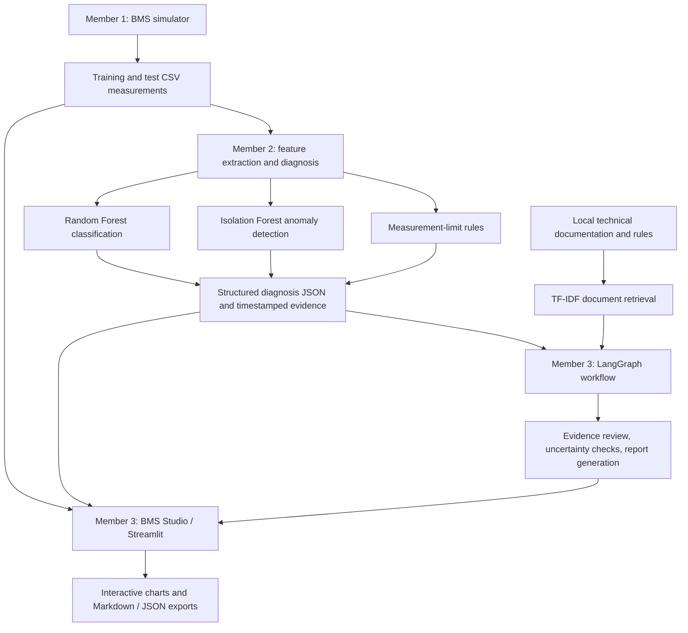

# Intelligent ECU Diagnosis — BMS Simulation, Machine Learning & Diagnostic Reporting

An academic proof of concept for **intelligent ECU diagnostics**, implemented on a **simulated Battery Management System (BMS)** use case. The project generates reproducible battery measurements, detects abnormal operating conditions, classifies simulated fault patterns, and produces traceable reports through an interactive dashboard.

The repository combines three components developed by the project team:

- **Member 1 — BMS simulation:** generates time-series measurements and injects known fault scenarios.
- **Member 2 — Rules and machine learning:** validates measurements, detects abnormal windows, classifies known fault patterns, and exports structured diagnostic evidence.
- **Member 3 — Dashboard and explainable reporting:** visualizes signals and evidence, coordinates a LangGraph workflow, retrieves local technical references, and exports diagnostic reports.

> **Current scope:** This is a prototype using **synthetic BMS data**, not a validated diagnostic system for production ECUs. The available data do not contain the protective-command responses, actuator feedback, or approved timing requirements needed to establish a functional ECU end-of-line (EOL) PASS/FAIL verdict.

## Architecture



The rule engine, anomaly detector, and classifier answer different questions. A measurement-limit violation is not itself a functional ECU failure; a classifier output identifies a pattern learned from the training data, not an independently confirmed physical root cause.

## Repository structure

```text
ECU-BMS-Project/
├── README.md
├── requirements.txt
├── requirements_m3.txt
├── .streamlit/
│   └── config.toml
├── member1_simulator/
│   ├── README.md
│   ├── python/generate_dataset.py
│   ├── config/battery_config.json
│   └── datasets/
│       ├── train.csv
│       └── test.csv
├── member2_ml/
│   ├── README.md
│   ├── src/bms_pipeline.py
│   ├── config/rules.json
│   ├── models/
│   ├── results/diagnoses.json
│   └── tests/
├── member3_agent_app/
│   ├── README.md
│   ├── app.py
│   ├── graph.py
│   ├── knowledge.py
│   ├── services/data_loader.py
│   └── tests/
└── docs/
    └── data_contract.md
```

For implementation details, see the component documentation:

- [Member 1 — BMS simulator](member1_simulator/README.md)
- [Member 2 — ML and rule-based diagnosis](member2_ml/README.md)
- [Member 3 — BMS Studio and LangGraph reporting](member3_agent_app/README.md)
- [Measurement data contract](docs/data_contract.md)

## Quick start

**Requirements:** Python 3.10+ and an environment with the required packages. Run these commands from the repository root.

### 1. Install dependencies

```bash
python -m pip install -r requirements.txt
python -m pip install -r requirements_m3.txt
```

### 2. Explore the pre-generated data

The repository contains simulated measurements and diagnostic JSON files. You can run the dashboard without retraining the models:

```bash
python -m streamlit run member3_agent_app/app.py --server.port 8502
```

Open `http://localhost:8502`, select a session in the sidebar, and navigate through **Vue d'ensemble**, **Signaux & preuves**, **Analyse ML**, and **Rapport**. The **Analyser la session avec LangGraph + RAG** action generates a locally sourced report. This version requires **no LLM or API key**.

### 3. Generate new simulated measurements (optional)

```bash
python member1_simulator/python/generate_dataset.py
```

This command regenerates the simulator's CSV outputs and may overwrite existing generated files. Retrain the models or regenerate diagnostic outputs as appropriate after changing the data.

### 4. Train, evaluate, and produce diagnostic JSON (optional)

```bash
python member2_ml/src/bms_pipeline.py features --input member1_simulator/datasets/train.csv --out member2_ml/results/train_session_features.csv
python member2_ml/src/bms_pipeline.py train
python member2_ml/src/bms_pipeline.py evaluate
python member2_ml/src/bms_pipeline.py predict --input member1_simulator/datasets/test.csv --out member2_ml/results/diagnoses.json
```

For single-session output:

```bash
python member2_ml/src/bms_pipeline.py predict --input member1_simulator/datasets/test.csv --session-id F02_R002 --out member2_ml/results/example_undervoltage_diagnosis.json
```

### 5. Run tests

```bash
python -m pytest -q member2_ml/tests
python -m pytest -q member3_agent_app/tests
python member3_agent_app/tests/smoke_all_sessions.py
```

The last command runs an integration smoke check against the available Member 1 and Member 2 outputs; see the [Member 3 README](member3_agent_app/README.md) for details.

## Dataset and simulated fault classes

The original dataset includes **160 simulated sessions**: 128 for training and 32 held-out sessions. Each session contains 121 timestamped measurements of pack voltage, pack current, temperature, and state of charge (SOC).

| ID | Simulated operating condition |
|---|---|
| `F00` | Normal operation |
| `F01` | Overvoltage |
| `F02` | Undervoltage |
| `F03` | Overcurrent |
| `F04` | Overtemperature |
| `F05` | Voltage-sensor fault |
| `F06` | Current-sensor fault |
| `F07` | Temperature-sensor fault |

The injected-fault labels serve as ground truth for simulation/evaluation and must **not** be used as predictive input features.

## Prototype evaluation

The Member 2 pipeline reported the following results on **32 held-out sessions from the same synthetic generator**:

| Model | Metric | Result |
|---|---|---|
| Random Forest | Fault-pattern classification accuracy | 32/32 (100%) |
| Isolation Forest | Fault-detection recall | 22/28 (78.6%) |
| Isolation Forest | Fault-detection precision | 22/22 (100%) |

These are **synthetic-data benchmarks**, not estimates of reliability on production ECU measurements. The held-out set contains four sessions per class, generated using the same simplified simulation assumptions as the training set.

## Diagnostic outputs and reporting

Member 2 produces `member2_ml/results/diagnoses.json`, a list of session-level objects using `schema_version: "1.1"`. Each report can contain:

- A session ID and data source;
- Configured measurement-limit status and timestamped evidence;
- Random Forest fault hypotheses and uncalibrated class scores;
- Isolation Forest anomaly windows;
- Missing information and recommended follow-up checks.

Member 3 correlates the JSON records with the time series in `member1_simulator/datasets/test.csv`, renders interactive plots and evidence views, and creates Markdown/JSON exports. The LangGraph workflow retrieves local reference passages with file/line citations, checks supported measurement rules, and preserves diagnostic uncertainty. It **does not modify** Member 2's original verdict or independently retrain the models.

For example, session `F02_R002` contains a suspected undervoltage pattern and a voltage measurement below the configured simulation threshold. This does **not** demonstrate that an ECU failed to respond correctly.

**Key distinction:** `measurement_limits_status: "LIMIT_VIOLATION"` means an illustrative measurement threshold was crossed. The functional `verdict` remains `"NOT_EVALUATED"` because ECU response signals, actuator feedback, and timing acceptance criteria are unavailable.

## Limitations and future scope

- The inputs are synthetic BMS measurements rather than independently validated physical ECU data.
- Raw CAN `.asc`/`.blf` decoding requires suitable DBC definitions and normalization; it is not part of the current end-to-end dashboard input path.
- Rule thresholds and battery parameters are illustrative, not approved OEM limits or EOL test plans.
- Machine-learning class scores are not calibrated probabilities of physical root causes.
- LangGraph coordinates a deterministic, **local** reporting workflow with TF-IDF document retrieval; there is no LLM, external AI API, or physical ECU interaction.
- A future ECU/EOL implementation would require command and feedback signals, test-plan acceptance criteria, timing checks, and validation on independent representative data.

Trained `.joblib` models should be loaded only from trusted sources. Vehicle recordings may contain confidential information and should not be published without authorization. This project makes no industrial safety-validation claim.

## Contributors

- [ririoua](https://github.com/ririoua) — **Member 1:** BMS simulation, fault injection, and dataset generation.
- [ARWA044](https://github.com/ARWA044) — **Member 2:** Machine learning, measurement-limit rules, and diagnostic JSON.
- [ihssanemaataoui66-code](https://github.com/ihssanemaataoui66-code) — **Member 3:** BMS Studio dashboard, LangGraph workflow, local RAG, explainable reporting, and integration tests.
