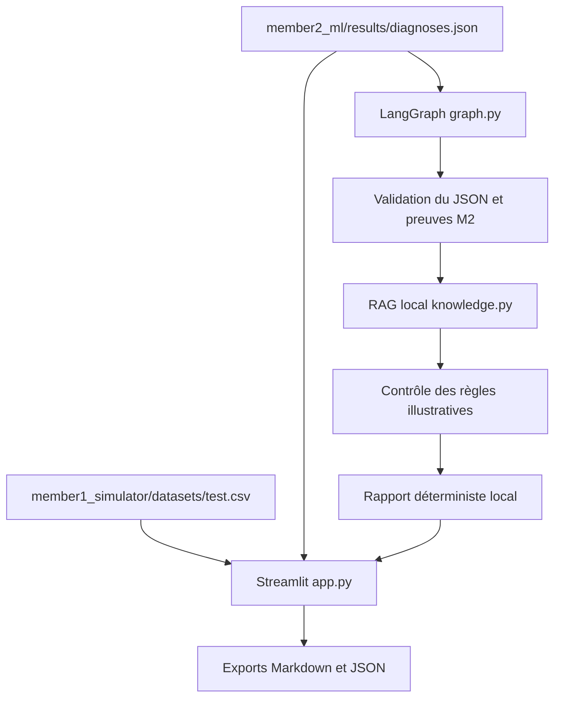

# BMS Studio — Module M3 complet (prototype académique)

Ce pack **ne contient pas** les datasets et les modèles M1/M2 : il lit directement les fichiers déjà présents dans `ECU-BMS-Project`.

## Contenu et architecture



Les cinq nœuds LangGraph sont `load_context`, `analyze_evidence`, `retrieve_docs`, `verify_uncertainty`, `build_report`.

## Installer dans Windows CMD

1. **Ne pas supprimer tes fichiers déjà opérationnels.** Sauvegarde-les :

```cmd
cd C:\Users\hp\ECU-BMS-Project
copy member3_agent_app\app.py "%TEMP%\BMS_app_avant_RAG.py"
copy member3_agent_app\graph.py "%TEMP%\BMS_graph_avant_RAG.py"
```

2. Télécharge `BMS_Studio_Sans_LLM.zip` dans `Téléchargements`. Puis, depuis la racine du dépôt :

```cmd
python -m zipfile -e "%USERPROFILE%\Downloads\BMS_Studio_Sans_LLM.zip" .
```

Cela place correctement les fichiers `member3_agent_app/`, `requirements_m3.txt` et `.streamlit/config.toml`. Ne copie pas un dossier ZIP entier dans un sous-dossier par erreur.

3. Installe les dépendances. Si ton environnement `.venv` existe, active-le ; sinon utilise le Python actuel qui fonctionnait déjà :

```cmd
python -m pip install -r requirements_m3.txt
```

4. Tests :

```cmd
python -m pytest -q member3_agent_app\tests
python -m member3_agent_app.graph
```

La commande `graph` doit produire un rapport sur la session `F02_R002`, avec preuves, références documentaires et précautions. **Un verdict `NOT_EVALUATED` ne doit pas être transformé en PASS ou FAIL.**

5. Lancer Streamlit :

```cmd
python -m streamlit run member3_agent_app\app.py --server.port 8502
```

Ouvre `http://localhost:8502`. Dans **Rapport**, sélectionne **Analyser la session avec LangGraph + RAG** pour générer un rapport local.

## Fonctionnement local

Le workflow LangGraph, le RAG documentaire, les contrôles de règles et les exports fonctionnent localement **sans clé API ni appel à un modèle externe**. Il n'y a pas d'option de rédaction LLM dans le code.

## Tests de validation finale

| Session | Attendu | Ne pas déduire |
|---|---|---|
| `F02_R002` | Sous-tension suspectée, preuve sous 300 V, fenêtres IF, références techniques | Cause physique confirmée, PASS/FAIL fonctionnel |
| `F00_R017` | Absence de défaut retenu dans le modèle sur les données simulées | Validation industrielle de l'ECU |
| Diagnostic M2 sans `evidence` | Message de validation, pas de faux rapport | Valeur inventée |
| Source documentaire absente | RAG signale qu'aucune référence n'est disponible | Source fabriquée |

**Limites :** les règles de `member2_ml/config/rules.json` et les paramètres `battery_config.json` sont illustratifs. Le dépôt ne contient pas de plan EOL OEM validé ni d'enregistrement physique d'ECU. Les 32 diagnostics déjà générés par M2 restent des résultats sur données synthétiques. Cette livraison permet de démontrer le **prototype M3**, pas d'affirmer une fiabilité de diagnostic industriel.

## Organisation Git (ne pas envoyer les dossiers ZIP extraits)

```cmd
git status
git add member3_agent_app/app.py member3_agent_app/graph.py member3_agent_app/knowledge.py member3_agent_app/tests member3_agent_app/__init__.py member3_agent_app/services/__init__.py .streamlit/config.toml requirements_m3.txt README_INSTALLATION_M3.md
git commit -m "Complete M3 local LangGraph and RAG reporting"
git push origin feature/member3-agentic-ai
```

Ces commandes sont à lancer **après les tests locaux**. Évite `git add .` pour ne pas envoyer des ZIP temporaires, les modèles `.joblib` ou des secrets.

## Qui fournit quoi ?

- **M1 :** mesure temporelle dans `test.csv` et documentation du simulateur ;
- **M2 :** diagnostics `diagnoses.json`, règles, preuves et modèles ;
- **M3 :** dashboard, workflow LangGraph, RAG local et rapports.

Le tableau de bord **n'entraîne pas les modèles** et **n'invente pas de mesures**. Si M2 actualise `diagnoses.json`, relance l'application ou rafraîchis les données mises en cache dans Streamlit.
