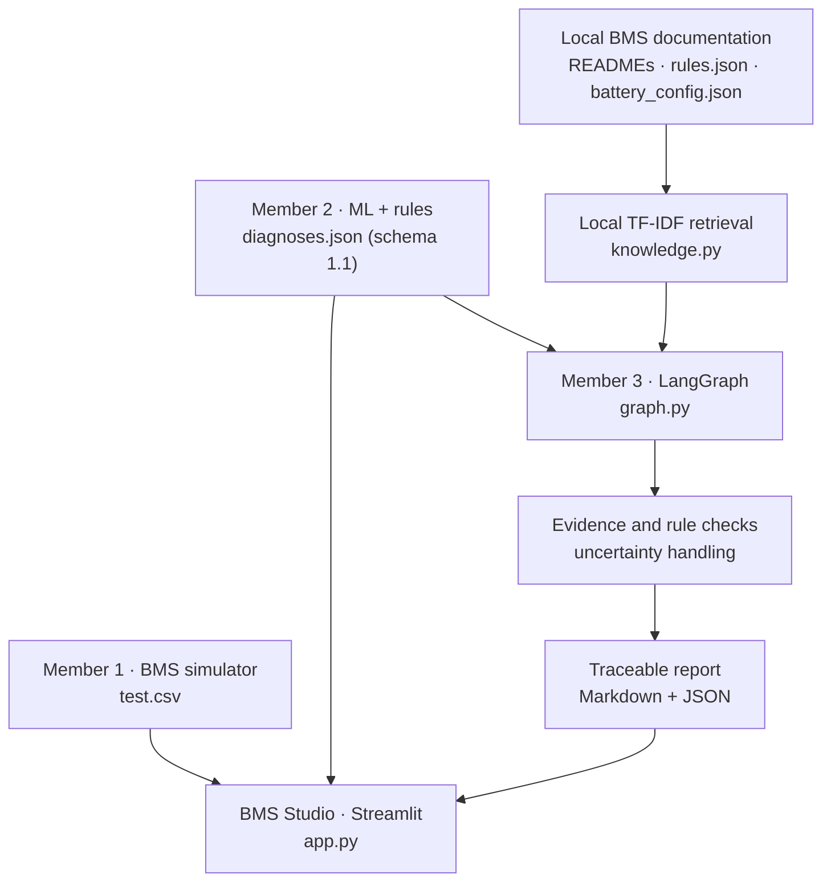

# Member 3 — BMS Studio: Explainable Diagnostic Dashboard & LangGraph Workflow

**Part of [Intelligent ECU Diagnosis — BMS case study](https://github.com/ARWA044/ECU-BMS-Project)**  
**Component owner:** [ihssanemaataoui66-code](https://github.com/ihssanemaataoui66-code) — Streamlit dashboard, diagnostic orchestration, local document retrieval, and reporting.

BMS Studio is the presentation and evidence-analysis component of an academic **ECU fault-diagnosis prototype applied to a simulated Battery Management System (BMS)**. It combines measurements from the BMS simulator (Member 1) with structured diagnostic results from the machine-learning pipeline (Member 2). It visualizes each session, checks the traceability and consistency of reported evidence, searches relevant technical documents, and exports structured reports.

**Scope and terminology:** The current implementation diagnoses *abnormal BMS measurements and suspected fault patterns*. It does **not** establish the functional PASS/FAIL verdict of an ECU end-of-line (EOL) test, confirm physical root causes, or validate a real battery. Those capabilities require ECU command/feedback signals, approved response times, functional test plans, and independent measurements that are not in the current dataset.

## Architecture



The LangGraph pipeline executes five **deterministic** nodes:

```text
START → load_context → analyze_evidence → retrieve_docs
      → verify_uncertainty → build_report → END
```

LangGraph manages the sequence of processing steps. The document retrieval is a **local, lexical TF-IDF search** with references to source files and line numbers. This version **does not use an LLM, an external API, autonomous tool-use agents, or a remote vector database**. The generated explanation is structured from the existing data and configured rules; it does not invent measurements or new diagnoses.

## Capabilities

| Area | Current implementation |
|---|---|
| Dashboard | Dark-theme Streamlit interface with session selection and diagnostic overview |
| Signals | Plotly time-series charts for voltage, current, temperature, and state of charge |
| Evidence | Time-stamped measurements, configured threshold markers, and anomalous-window overlays |
| ML results | Displays Random Forest hypotheses and Isolation Forest anomaly windows from Member 2 |
| LangGraph | Runs evidence collection, local retrieval, rule checks, uncertainty handling, and report generation |
| Local RAG | Finds relevant passages in a curated list of repository documents, with file/line references |
| Reports | Downloads original diagnosis JSON, descriptive Markdown, enriched LangGraph Markdown and JSON |
| Data input | Uses repository files by default; supports optional JSON and CSV uploads |

## Integration contracts

### Input from Member 1: measurements

Default file: [`../member1_simulator/datasets/test.csv`](../member1_simulator/datasets/test.csv)

The dashboard requires these CSV columns:

| Column | Meaning |
|---|---|
| `scenario_id` | Identifier of an individual simulated session |
| `timestamp_s` | Measurement timestamp in seconds |
| `pack_voltage_v` | Pack voltage in volts |
| `pack_current_a` | Pack current in amperes |
| `temperature_c` | Battery temperature in °C |
| `soc_pct` | State of charge in percent |

Other simulator columns may exist, including injected-fault labels. **The dashboard selects the measured columns for visualization; the ML pipeline must not use simulator ground-truth labels as input features.**

### Input from Member 2: diagnosis results

Default file: [`../member2_ml/results/diagnoses.json`](../member2_ml/results/diagnoses.json)

This file is a **list of diagnostic objects**, one per session. The dashboard also accepts a single diagnostic object when a JSON file is uploaded. Every displayed report must correspond to its CSV session through:

```text
Member 2 diagnosis.session_id == Member 1 measurements.scenario_id
```

The contract uses `schema_version: "1.1"` and fields such as `verdict`, `measurement_limits_status`, `detected_fault`, `probable_causes`, `anomaly_detection`, `evidence`, `diagnostic_status`, `missing_info`, `recommended_test`, and `recommended_test_done`.

A real example of the current pipeline is [`../member2_ml/results/example_undervoltage_diagnosis.json`](../member2_ml/results/example_undervoltage_diagnosis.json). For session `F02_R002`, it describes a suspected `UNDERVOLTAGE` pattern and a `pack_voltage_v` evidence point of approximately **289.57 V at 62 s**, below the simulator's illustrative **300 V** limit. The Random Forest class score is **uncalibrated**: it is not the probability of a confirmed physical root cause.

**Interpretation rules:**

- `verdict: "NOT_EVALUATED"` means the ECU functional acceptance test was **not** performed. It must not be displayed as PASS or FAIL.
- `measurement_limits_status: "LIMIT_VIOLATION"` means a configured *measurement* limit was crossed, not that a protective ECU response failed.
- `detected_fault` and `probable_causes` describe supported **hypotheses**, not verified hardware failures.
- `recommended_test_done: false` means the suggested check has **not** been performed.
- `rag_sources[].relevance` measures lexical retrieval similarity, **not** evidence strength or diagnostic confidence.

## Repository layout

```text
ECU-BMS-Project/
├── member1_simulator/
│   └── datasets/test.csv             # M1: synthetic time-series measurements
├── member2_ml/
│   ├── config/rules.json             # M2: illustrative measurement rules
│   └── results/diagnoses.json        # M2: ML/rules output (schema 1.1)
├── member3_agent_app/
│   ├── README.md                     # This document
│   ├── app.py                        # Main Streamlit UI
│   ├── graph.py                      # LangGraph nodes and workflow
│   ├── knowledge.py                  # Local TF-IDF retrieval and rule checks
│   ├── services/data_loader.py       # Default CSV/JSON loading
│   └── tests/
│       ├── test_workflow.py
│       ├── test_knowledge.py
│       └── smoke_all_sessions.py     # End-to-end smoke test (optional)
├── .streamlit/config.toml            # Application theme
└── requirements_m3.txt               # M3 dependencies
```

Launch **`app.py`** for the integrated application. The module does not require local backup files or earlier dashboard prototypes.

## Setup and launch (Windows CMD)

Run these commands from the **repository root**, not from inside `member3_agent_app`:

```cmd
cd C:\path\to\ECU-BMS-Project
python -m venv .venv
.venv\Scripts\activate
python -m pip install -r requirements_m3.txt
python -m streamlit run member3_agent_app\app.py --server.port 8502
```

Open **http://localhost:8502**. If you already have a working virtual environment, activate it instead of creating a new one.

**No model training or OpenAI API key is required to view the pre-generated results.** The application reads the files already committed by Members 1 and 2. Model training and new inference are owned by Member 2.

### Using the dashboard

1. Select a BMS session in the sidebar. The default dataset currently contains **32 held-out synthetic sessions**.
2. Open **Vue d'ensemble** to see the measurement-limit status, suspected fault, and timeline.
3. Open **Signaux & preuves** to inspect interactive curves, referenced observations, and model anomaly windows.
4. Open **Analyse ML** for class hypotheses, anomaly results, and recommended checks.
5. Open **Rapport** and select **Analyser la session avec LangGraph + RAG** to generate the documented local synthesis; download its Markdown or JSON export.

The sidebar optionally accepts an alternate M2 JSON and an alternate M1 CSV. Ensure they use compatible formats and refer to the **same session identifiers**. The sidebar uploads do not retrain the models.

## Tests and verification

Install development dependencies using `requirements_m3.txt`, then execute:

```cmd
python -m pytest -q member3_agent_app\tests
python -m member3_agent_app.graph
python member3_agent_app\tests\smoke_all_sessions.py
```

The existing unit tests check accepted and rejected diagnostic inputs, uncertainty handling, normal sessions, document retrieval, and rule comparisons. The smoke-test script runs the real workflow on **every diagnosis** in the configured JSON and checks session alignment and report/source integrity. The integration smoke test reads the current CSV and JSON outputs without retraining models.

Suggested manual acceptance checks:

| Session | Expected display |
|---|---|
| `F00_R017` | No fault retained; measurements displayed; functional verdict remains `NOT_EVALUATED` |
| `F02_R002` | Suspected undervoltage, supporting voltage evidence, anomaly windows, and RAG references |

Also verify that every report uses the selected session, all four signals can be plotted, exported Markdown/JSON files open, and no unexecuted confirmation test is represented as completed.

### Reproducibility and integration

When updated diagnostics are produced by Member 2, refresh the Streamlit session or clear Streamlit's cached data if the dashboard still displays older results. The dashboard does not execute `bms_pipeline.py` itself.

## Technical limitations and safety

- Data are **synthetic BMS measurements**, not production vehicle logs or independently validated physical measurements.
- This version does not decode raw `.asc`/`.blf` CAN recordings; that requires the appropriate DBC decoding and normalization stages.
- Limits in `rules.json` and `battery_config.json` are **illustrative simulation settings**, not approved OEM requirements.
- ECU protective commands, actuator feedback, response deadlines, and an approved EOL test plan are missing. Functional ECU PASS/FAIL therefore remains **`NOT_EVALUATED`**.
- Classifier scores are not calibrated physical root-cause confidence estimates. The current test sessions are drawn from the same simplified generator as the training sessions.
- The RAG retrieval is lexical; a retrieved document supports *context and traceability*, not automatic confirmation of a cause.
- The LangGraph workflow is deterministic and has **no LLM component**. It does not independently diagnose new physical faults or operate hardware.

## Future development

To extend the prototype toward the original ECU/EOL objectives, the system would need approved functional test plans, actual or representative ECU command/feedback signals, timing-based checks, and independent validation. These capabilities are **not** claimed by the current prototype.

## Contributors

- [ririoua](https://github.com/ririoua) — **Member 1:** BMS simulation, fault injection, and dataset generation.
- [ARWA044](https://github.com/ARWA044) — **Member 2:** Machine learning, rule-based checks, and structured diagnostic evidence.
- [ihssanemaataoui66-code](https://github.com/ihssanemaataoui66-code) — **Member 3:** Streamlit interface, LangGraph orchestration, local RAG, diagnostic reports, and tests.

